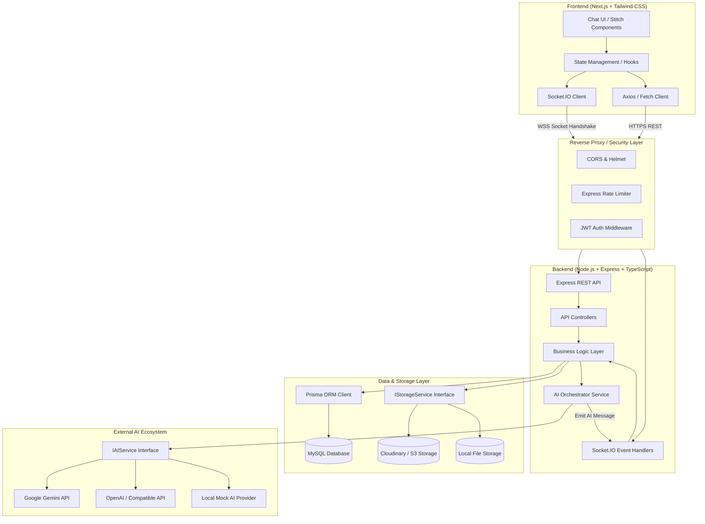
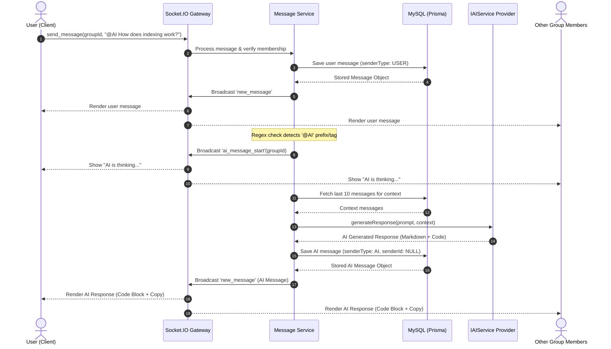

# Technical Architecture Document

## Project: Simple Group Chat with AI

**Status:** Approved Technical Architecture  
**Visual Reference:** Google Stitch Design System (`9667751278078556107`)  
**Lead Product Engineer:** Antigravity Team  

---

## 1. High-Level System Architecture

The application adopts a decoupled client-server architecture consisting of a **Next.js (React + TypeScript) Frontend**, a **Node.js (Express + TypeScript) Backend**, a **Socket.IO Real-Time Gateway**, a **MySQL Database managed by Prisma ORM**, an **Abstracted File Storage Service**, and an **Abstracted AI Service**.



---

## 2. Directory Structure

The project maintains a clean two-tier monorepo structure:

```text
chat-app/
├── docs/                             # Engineering documentation
│   ├── PRD.md
│   ├── ARCHITECTURE.md
│   ├── DATABASE.md
│   ├── API.md
│   ├── SOCKET_EVENTS.md
│   ├── SECURITY.md
│   └── DEVELOPMENT_PLAN.md
│
├── frontend/                         # Next.js Application
│   ├── public/                       # Static assets
│   ├── src/
│   │   ├── app/                      # Next.js App Router (pages & layouts)
│   │   │   ├── (auth)/
│   │   │   │   ├── login/page.tsx
│   │   │   │   └── register/page.tsx
│   │   │   ├── chat/
│   │   │   │   ├── layout.tsx
│   │   │   │   └── [groupId]/page.tsx
│   │   │   ├── layout.tsx
│   │   │   └── page.tsx
│   │   ├── components/               # Stitch UI Components
│   │   │   ├── chat/
│   │   │   │   ├── ChatHeader.tsx
│   │   │   │   ├── MessageList.tsx
│   │   │   │   ├── MessageBubble.tsx
│   │   │   │   ├── MessageInput.tsx
│   │   │   │   ├── MediaUploader.tsx
│   │   │   │   ├── VoiceRecorder.tsx
│   │   │   │   └── CodeBlock.tsx
│   │   │   ├── groups/
│   │   │   │   ├── GroupList.tsx
│   │   │   │   ├── GroupItem.tsx
│   │   │   │   ├── CreateGroupModal.tsx
│   │   │   │   └── GroupSettingsModal.tsx
│   │   │   ├── common/
│   │   │   │   ├── Avatar.tsx
│   │   │   │   ├── Button.tsx
│   │   │   │   ├── Modal.tsx
│   │   │   │   └── Toast.tsx
│   │   ├── hooks/                    # Custom React hooks
│   │   │   ├── useAuth.ts
│   │   │   ├── useSocket.ts
│   │   │   ├── useChat.ts
│   │   │   └── useVoiceRecord.ts
│   │   ├── services/                 # API client services
│   │   │   ├── api.ts
│   │   │   ├── auth.service.ts
│   │   │   └── group.service.ts
│   │   ├── types/                    # Shared TypeScript interfaces
│   │   └── lib/                      # Utilities & constants
│   ├── tailwind.config.ts
│   ├── tsconfig.json
│   └── package.json
│
└── backend/                          # Node.js Express Application
    ├── prisma/
    │   ├── schema.prisma             # Database schema
    │   └── migrations/
    ├── src/
    │   ├── config/                   # Environment & constant configs
    │   │   ├── env.ts
    │   │   └── constants.ts
    │   ├── controllers/              # REST controllers
    │   │   ├── auth.controller.ts
    │   │   ├── group.controller.ts
    │   │   ├── message.controller.ts
    │   │   └── user.controller.ts
    │   ├── middlewares/              # Security & utility middlewares
    │   │   ├── auth.middleware.ts
    │   │   ├── rateLimiter.ts
    │   │   ├── upload.middleware.ts
    │   │   └── validate.middleware.ts
    │   ├── routes/                   # Express route definitions
    │   │   ├── auth.routes.ts
    │   │   ├── group.routes.ts
    │   │   ├── message.routes.ts
    │   │   └── user.routes.ts
    │   ├── services/                 # Core business logic
    │   │   ├── auth.service.ts
    │   │   ├── group.service.ts
    │   │   ├── message.service.ts
    │   │   ├── ai/                   # AI Service Abstraction
    │   │   │   ├── ai.interface.ts
    │   │   │   ├── gemini.service.ts
    │   │   │   ├── openai.service.ts
    │   │   │   ├── mock.service.ts
    │   │   │   └── ai.factory.ts
    │   │   └── storage/              # Storage Service Abstraction
    │   │       ├── storage.interface.ts
    │   │       ├── local.storage.ts
    │   │       ├── cloudinary.storage.ts
    │   │       ├── s3.storage.ts
    │   │       └── storage.factory.ts
    │   ├── socket/                   # Socket.IO handlers
    │   │   ├── index.ts
    │   │   ├── socketAuth.middleware.ts
    │   │   └── handlers/
    │   │       ├── chat.handler.ts
    │   │       └── group.handler.ts
    │   ├── types/                    # Backend TypeScript types
    │   ├── utils/                    # Helper functions & logger
    │   └── index.ts                  # Server entry point
    ├── tsconfig.json
    └── package.json
```

---

## 3. Frontend Architecture

### 3.1 Next.js 14/15 App Router & Tech Stack
- **Framework:** Next.js with React 18/19 and TypeScript in Strict mode.
- **Styling:** Tailwind CSS with custom theme extensions mirroring Stitch UI tokens (`dark:bg-[#0B0F19]`, `text-slate-100`, `indigo-500` accents).
- **Icons:** `lucide-react` for consistent, lightweight vector icons.
- **Markdown & Code Rendering:**
  - `react-markdown` + `remark-gfm` for tables and text formatting.
  - `prismjs` or `shiki` syntax highlighter for multi-language code snippets.
  - Interactive "Copy Code" action with notification tooltip.

### 3.2 Real-time Socket Connection Lifecycle
- A singleton `SocketClient` instance manages connection health, authentication token injection, and automatic reconnect with exponential backoff.
- Connection state is exposed to the UI via `useSocket` hook.
- When navigating to `/chat/[groupId]`, the client sends `join_group` and registers listeners for incoming messages, AI streaming/start indicators, and typing events.

---

## 4. Backend Architecture

### 4.1 Layered Responsibility Pattern
1. **Routing Layer:** Maps HTTP endpoints, applies validation schemas (`zod`), attaches upload middleware, and applies rate limiters.
2. **Controller Layer:** Parses validated DTOs, extracts authenticated user session (`req.user`), delegates to services, and formats standard JSON responses.
3. **Service Layer:** Houses pure business logic, transactional operations, and access control validation.
4. **Socket.IO Layer:** Mirrors service validations. Every socket event verifies user session and active group membership before executing any operation.

### 4.2 Storage Service Abstraction (`IStorageService`)

All file handling (images, videos, documents, audio) is decoupled via an interface:

```typescript
export interface StorageUploadResult {
  fileUrl: string;
  fileKey: string;
  fileName: string;
  fileSize: number;
  mimeType: string;
}

export interface IStorageService {
  uploadFile(
    fileBuffer: Buffer,
    fileName: string,
    mimeType: string,
    destinationFolder: string
  ): Promise<StorageUploadResult>;

  deleteFile(fileKey: string): Promise<void>;
  
  getPublicUrl(fileKey: string): string;
}
```

**Supported Drivers:**
1. `LocalStorageService`: Writes directly to `backend/uploads/` (ideal for zero-credential local development).
2. `CloudinaryStorageService`: Streams files to Cloudinary CDN.
3. `S3StorageService`: Works with AWS S3, MinIO, or DigitalOcean Spaces.
- Factory selection based on `STORAGE_PROVIDER` environment variable (`local`, `cloudinary`, `s3`).

---

## 5. AI Assistant Integration Architecture

### 5.1 AI Service Abstraction (`IAIService`)

```typescript
export interface AIChatMessage {
  role: 'user' | 'assistant' | 'system';
  content: string;
}

export interface AIResponseResult {
  content: string;
  usage?: {
    promptTokens: number;
    completionTokens: number;
  };
}

export interface IAIService {
  generateResponse(
    prompt: string,
    history: AIChatMessage[]
  ): Promise<AIResponseResult>;
}
```

**Supported Providers:**
- `GeminiAIService`: Uses `@google/genai` or `@google/generative-ai` SDK.
- `OpenAIService`: Uses official `openai` SDK or compatible endpoints.
- `MockAIService`: Predictable mocked responses for automated tests and offline mode.
- Factory selection based on `AI_PROVIDER` environment variable (`gemini`, `openai`, `mock`).

### 5.2 `@AI` End-to-End Execution Flow



### 5.3 Critical AI Security Constraints
1. **No Code Execution:** The backend will never invoke `eval()`, spawn shell executions, execute child processes, or interpret code generated by the AI model.
2. **Context Filtering:** Sensitive group metadata (passwords, auth tokens, deleted messages) is stripped before prompt dispatch.
3. **Rate Limiting:** AI invocations are capped to 10 requests per minute per group to prevent API exhaustion and denial-of-service.

---

## 6. Real-Time Socket Architecture

- **Room Partitioning:** Each group maps directly to a Socket.IO room `group:${groupId}`.
- **Connection Handshake:**
  - Client supplies JWT access token in `socket.handshake.auth.token`.
  - Middleware decodes token and verifies user validity in MySQL.
  - Rejection with error code on expired or forged tokens.
- **Room Join Authorization:**
  - Client issues `join_group` with `groupId`.
  - Server executes database check: `GroupMember.findFirst({ where: { groupId, userId } })`.
  - If member exists: client joins room and receives status acknowledgment.
  - If not a member: connection receives unauthorized error event and cannot eavesdrop on room events.
