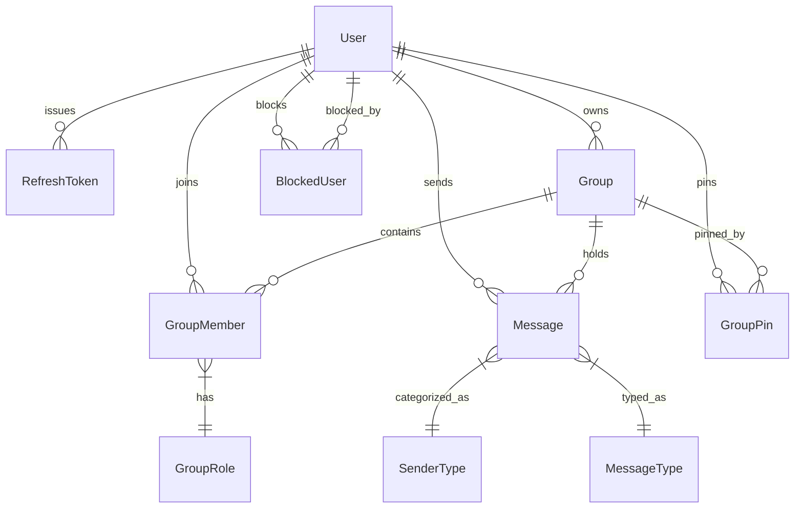

# Database Entity & Schema Design Plan

## Project: Simple Group Chat with AI

**Status:** Approved Database Specification  
**Database Engine:** MySQL 8.0+  
**ORM:** Prisma ORM  
**Lead Product Engineer:** Antigravity Team  

---

## 1. Entity-Relationship Overview

The database is designed with normalized relational models optimized for high-throughput messaging, instant room membership lookups, and fast cursor-based pagination.



---

## 2. Complete Prisma Schema (`schema.prisma`)

```prisma
datasource db {
  provider = "mysql"
  url      = env("DATABASE_URL")
}

generator client {
  provider = "prisma-client-js"
}

enum GroupRole {
  OWNER
  ADMIN
  MEMBER
}

enum SenderType {
  USER
  AI
  SYSTEM
}

enum MessageType {
  TEXT
  IMAGE
  VIDEO
  FILE
  AUDIO
}

model User {
  id           String        @id @default(uuid())
  email        String        @unique
  username     String        @unique
  displayName  String
  passwordHash String
  avatarUrl    String?       @db.VarChar(512)
  createdAt    DateTime      @default(now())
  updatedAt    DateTime      @updatedAt

  // Relationships
  refreshTokens RefreshToken[]
  ownedGroups   Group[]        @relation("GroupOwner")
  memberships   GroupMember[]
  messages      Message[]
  groupPins     GroupPin[]
  
  // Blocking relations
  blockedUsers  BlockedUser[]  @relation("BlockerRelation")
  blockedBy     BlockedUser[]  @relation("BlockedRelation")

  @@index([username])
  @@index([email])
}

model RefreshToken {
  id        String    @id @default(uuid())
  tokenHash String    @unique
  userId    String
  user      User      @relation(fields: [userId], references: [id], onDelete: Cascade)
  expiresAt DateTime
  revokedAt DateTime?
  createdAt DateTime  @default(now())

  @@index([userId])
  @@index([tokenHash])
}

model Group {
  id          String        @id @default(uuid())
  name        String        @db.VarChar(100)
  description String?       @db.Text
  avatarUrl   String?       @db.VarChar(512)
  ownerId     String
  owner       User          @relation("GroupOwner", fields: [ownerId], references: [id], onDelete: Restrict)
  createdAt   DateTime      @default(now())
  updatedAt   DateTime      @updatedAt

  // Relationships
  members     GroupMember[]
  messages    Message[]
  pins        GroupPin[]

  @@index([ownerId])
  @@index([updatedAt])
}

model GroupMember {
  id        String    @id @default(uuid())
  groupId   String
  group     Group     @relation(fields: [groupId], references: [id], onDelete: Cascade)
  userId    String
  user      User      @relation(fields: [userId], references: [id], onDelete: Cascade)
  role      GroupRole @default(MEMBER)
  joinedAt  DateTime  @default(now())

  @@unique([groupId, userId])
  @@index([userId])
  @@index([groupId, role])
}

model Message {
  id            String      @id @default(uuid())
  groupId       String
  group         Group       @relation(fields: [groupId], references: [id], onDelete: Cascade)
  
  // Nullable when message is emitted by AI or System
  senderId      String?
  sender        User?       @relation(fields: [senderId], references: [id], onDelete: SetNull)
  
  senderType    SenderType  @default(USER)
  messageType   MessageType @default(TEXT)
  
  // Stores text message, markdown, or AI explanation/code
  content       String?     @db.LongText
  
  // URL to media stored on S3/Cloudinary/Local disk
  mediaUrl      String?     @db.VarChar(512)
  
  // Metadata JSON for media dimensions, duration, filename, code languages
  // e.g. { fileName: "report.pdf", fileSize: 204850, mimeType: "application/pdf", durationSec: 42 }
  mediaMetadata Json?

  createdAt     DateTime    @default(now())
  updatedAt     DateTime    @updatedAt

  @@index([groupId, createdAt(sort: Desc)])
  @@index([senderId])
}

model GroupPin {
  id        String   @id @default(uuid())
  userId    String
  user      User     @relation(fields: [userId], references: [id], onDelete: Cascade)
  groupId   String
  group     Group    @relation(fields: [groupId], references: [id], onDelete: Cascade)
  pinnedAt  DateTime @default(now())

  @@unique([userId, groupId])
  @@index([userId])
  @@index([groupId])
}

model BlockedUser {
  id        String   @id @default(uuid())
  blockerId String
  blocker   User     @relation("BlockerRelation", fields: [blockerId], references: [id], onDelete: Cascade)
  blockedId String
  blocked   User     @relation("BlockedRelation", fields: [blockedId], references: [id], onDelete: Cascade)
  createdAt DateTime @default(now())

  @@unique([blockerId, blockedId])
  @@index([blockerId])
  @@index([blockedId])
}
```

---

## 3. Entity Details & Invariants

### 3.1 `User`
- **Invariants:**
  - `email` and `username` must be lowercase and unique.
  - `passwordHash` uses bcrypt with a minimum salt rounds of 12 (or Argon2id).
  - Deleting a user cascades refresh tokens, pins, and memberships, while preserving messages with `senderId = NULL` (sender rendered as "Former Member").

### 3.2 `Group` & `GroupMember`
- **Invariants:**
  - Every group must have exactly one active `OWNER`.
  - The creator of a group is assigned as `OWNER` during group creation in an atomic database transaction.
  - Ownership transfer is an atomic operation: updates current Owner to `ADMIN` and designated Admin to `OWNER`.
  - Unique compound constraint `@@unique([groupId, userId])` prevents duplicate memberships.

### 3.3 `Message`
- **Invariants:**
  - If `senderType === 'USER'`, `senderId` must point to an active user who was a member of `groupId` at `createdAt`.
  - If `senderType === 'AI'`, `senderId` is `NULL`, and `senderType` denotes the message was generated by the backend AI worker.
  - `content` can hold up to 4GB of text (`@db.LongText`), allowing complete AI code blocks, markdown reports, or documentation.
  - `mediaMetadata` schema:
    ```typescript
    interface MediaMetadata {
      fileName?: string;
      fileSize?: number;
      mimeType?: string;
      dimensions?: { width: number; height: number }; // For images/videos
      durationSec?: number; // For voice messages/videos
      codeLanguage?: string; // For formatted code snippets
    }
    ```

### 3.4 `GroupPin` (User-Centric Group Priority)
- Stored as a many-to-many relationship between `User` and `Group`.
- A user can pin multiple groups.
- Queries for user groups join `GroupPin` to sort pinned groups before unpinned groups (`ORDER BY isPinned DESC, lastMessageAt DESC`).

### 3.5 `BlockedUser`
- User A blocks User B creates `(blockerId: A, blockedId: B)`.
- Prevents User B from being queried or adding User A to groups.
- Messages from User B are flagged in group message queries so frontend can collapse them with the "Message from blocked user" overlay.

---

## 4. Query Performance & Indexing Strategy

1. **Message Feed Pagination:**
   - Index: `@@index([groupId, createdAt(sort: Desc)])`
   - Enables ultra-fast cursor pagination:
     ```sql
     SELECT * FROM Message 
     WHERE groupId = :groupId AND createdAt < :cursorTimestamp 
     ORDER BY createdAt DESC 
     LIMIT 50;
     ```
2. **User Group Sidebar Query:**
   - Index on `GroupMember(userId)` allows instant retrieval of all groups a user belongs to.
   - Pinned status joined via `GroupPin(userId, groupId)`.
3. **Membership Verification in Socket Handler:**
   - Index on `GroupMember(groupId, userId)` checks user authorization in `< 1ms`.

---

## 5. Migration & Seeding Plan

1. **Migration Tooling:** `npx prisma migrate dev --name init_schema` produces atomic SQL migration files.
2. **Local Seeding (`prisma/seed.ts`):**
   - Creates 3 sample users: `alice@example.com`, `bob@example.com`, `charlie@example.com` with hashed default passwords.
   - Creates a sample group: "Full-Stack Engineers" with Alice as Owner, Bob as Admin, and Charlie as Member.
   - Populates initial sample messages including an AI question and response demonstration.
