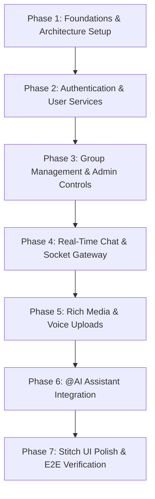

# Phased Development & Implementation Plan

## Project: Simple Group Chat with AI

**Status:** Approved Roadmap  
**Visual Reference:** Google Stitch Design System (`9667751278078556107`)  
**Lead Product Engineer:** Antigravity Team  

---

## 1. Overview & Execution Strategy

Development is structured into **7 sequential, test-driven phases**. Each phase contains explicit objectives, technical deliverables, and verification checkpoints that must be validated before progressing to the subsequent phase.

---

## 2. Phase Breakdown

### Phase 1: Foundations & Architecture Setup
**Objective:** Establish monorepo structure, development tooling, Express server, Next.js app, MySQL database with Prisma, and environment configurations.

- **Tasks:**
  1. Initialize workspace directories: `chat-app/frontend` and `chat-app/backend`.
  2. Setup Backend: Node.js, Express, TypeScript, ts-node-dev, Prisma ORM, CORS, Helmet, dotenv.
  3. Setup Docker Compose configuration for local MySQL 8.0 instance.
  4. Write Prisma schema (`schema.prisma`) and run initial database migration.
  5. Setup Frontend: Next.js (App Router), TypeScript, Tailwind CSS, Lucide icons.
  6. Configure Tailwind CSS theme tokens matching Google Stitch palette (deep slate `#0B0F19`, `#111827`, `#1F2937`, electric indigo `#6366F1`).
- **Deliverables:**
  - Running backend API server with health-check endpoint (`GET /api/health`).
  - Running Next.js frontend rendering basic layout.
  - Connected and migrated MySQL database.
- **Verification Criteria:**
  - Database connectivity test passes.
  - TypeScript compiles with zero errors on both backend and frontend.

---

### Phase 2: Authentication & User Services
**Objective:** Implement secure user registration, login, JWT and refresh token rotation, user search, and user blocking.

- **Tasks:**
  1. Backend: Implement password hashing with `bcrypt` (12 rounds).
  2. Backend: Implement JWT generation (15m access token) and database-backed refresh tokens (7d).
  3. Backend: Implement `/api/auth/register`, `/api/auth/login`, `/api/auth/refresh`, `/api/auth/logout`, `/api/auth/me`.
  4. Backend: Implement `/api/users/search`, `/api/users/block/:userId`, `/api/users/block/:userId` (unblock).
  5. Frontend: Build Stitch-inspired Auth views (Login & Register cards with sleek inputs, error toasts, and loading states).
  6. Frontend: Build `useAuth` hook and Axios/Fetch interceptor handling transparent token refresh.
- **Deliverables:**
  - Complete, secure auth pipeline with refresh token rotation.
  - Clean authentication pages matching Stitch design language.
- **Verification Criteria:**
  - Automated or manual verification of user registration, login, invalid password rejection, token refresh, and logout revocation.

---

### Phase 3: Group Management, Governance & Pinning
**Objective:** Deliver group lifecycle operations, role-based admin controls (Owner, Admin, Member), and personal group pinning.

- **Tasks:**
  1. Backend: Implement Group CRUD controllers and services (`POST /api/groups`, `GET /api/groups`, `GET /api/groups/:groupId`, `PATCH /api/groups/:groupId`, `DELETE /api/groups/:groupId`).
  2. Backend: Implement group pinning (`POST /api/groups/:groupId/pin`, `DELETE /api/groups/:groupId/pin`).
  3. Backend: Implement Admin control endpoints (add member, remove member, update member role).
  4. Backend: Implement `requireGroupRole` middleware enforcing RBAC rules.
  5. Frontend: Build Group Sidebar (`GroupList`, `GroupItem`) with pinned groups pinned to top, unread count, and last message snippet.
  6. Frontend: Build `CreateGroupModal` with member selection and validation.
  7. Frontend: Build Group Settings & Member Management drawer for Owner and Admins.
- **Deliverables:**
  - Full group lifecycle with role-based member governance.
  - Group list sidebar and creation flow matching Stitch layout.
- **Verification Criteria:**
  - Member promotion/demotion operates strictly according to permissions.
  - Non-members are blocked with 403 Forbidden.
  - Group pinning correctly re-orders groups for the current user.

---

### Phase 4: Real-Time Chat & Socket Gateway
**Objective:** Implement bidirectional real-time messaging, Socket.IO room management, cursor-based pagination, and typing indicators.

- **Tasks:**
  1. Backend: Initialize Socket.IO server with JWT handshake authentication middleware.
  2. Backend: Implement `join_group`, `leave_group`, `send_message`, `typing_start`, `typing_stop` handlers.
  3. Backend: Implement message persistence in MySQL and real-time room broadcasting.
  4. Backend: Implement cursor-based message history endpoint (`GET /api/groups/:groupId/messages`).
  5. Frontend: Implement `SocketClient` singleton with auto-reconnection and event dispatchers.
  6. Frontend: Build `ChatHeader`, `MessageList`, `MessageBubble`, and `MessageInput`.
  7. Frontend: Implement optimistic message sending with `tempId` and status markers.
  8. Frontend: Integrate typing indicators ("Alex is typing...").
- **Deliverables:**
  - Instant real-time text chat across multiple browser tabs/sessions.
  - Infinite scroll / cursor-based message history loading.
- **Verification Criteria:**
  - Sub-100ms message delivery between two connected sessions.
  - Only authorized group members receive broadcasts.
  - Optimistic updates smoothly reconcile with server-assigned IDs.

---

### Phase 5: Rich Media & Voice Sharing
**Objective:** Implement file storage abstraction (Local, Cloudinary, S3), media upload endpoints, and viewers for images, videos, files, and voice notes.

- **Tasks:**
  1. Backend: Create `IStorageService` interface and implement `LocalStorageService` (development default) plus `CloudinaryStorageService` and `S3StorageService`.
  2. Backend: Create multer upload middleware with MIME-type validation and size limits (Image: 10MB, Video: 50MB, Audio: 15MB, File: 25MB).
  3. Backend: Implement `POST /api/groups/:groupId/upload` endpoint.
  4. Frontend: Build `MediaUploader` supporting drag-and-drop file selection with upload progress bar.
  5. Frontend: Implement `VoiceRecorder` using the Web MediaStream / MediaRecorder API to record audio clips.
  6. Frontend: Build custom media message renderers:
     - Image: Thumbnail grid with full-screen lightbox modal.
     - Video: Native player container with custom controls.
     - File: Document card with extension icon, file size, and download button.
     - Audio: Audio waveform player with play/pause and duration indicator.
- **Deliverables:**
  - Flexible file storage system supporting local and cloud targets.
  - Comprehensive media sharing suite in the chat timeline.
- **Verification Criteria:**
  - Disallowed file types (.exe, scripts) are rejected with clear error messages.
  - Voice notes record in browser, upload, and play back smoothly for all members.

---

### Phase 6: AI Assistant Integration (`@AI` in Group Chat)
**Objective:** Implement native `@AI` assistant inside group chat threads with syntax-highlighted code blocks, copy action, and absolute code execution safety.

- **Tasks:**
  1. Backend: Create `IAIService` interface with `GeminiAIService`, `OpenAIService`, and `MockAIService`.
  2. Backend: Implement `@AI` regex parser in the message pipeline.
  3. Backend: Implement asynchronous AI orchestrator worker:
     - Emits `ai_message_start` event to group room.
     - Fetches recent group context (last 10 messages).
     - Calls `IAIService.generateResponse(prompt, history)`.
     - Persists AI message in MySQL with `senderType = 'AI'`.
     - Emits `new_message` to group room with complete markdown/code content.
  4. Backend: Enforce AI rate limiting (max 10 queries/min per group).
  5. Frontend: Build `AIMessageBubble` with distinctive Stitch styling (gradient badge, AI tag).
  6. Frontend: Implement `CodeBlock` component with syntax highlighting, language label, and one-click "Copy Code" button.
  7. **Security Guarantee:** Verify zero execution of AI code anywhere in client or server.
- **Deliverables:**
  - Seamless `@AI` interactions directly in group chat threads.
  - Beautiful syntax-highlighted code blocks with instant copy functionality.
- **Verification Criteria:**
  - Typing `@AI explain binary search` generates a formatted explanation with code block in the chat.
  - All group members see the AI question and response simultaneously.

---

### Phase 7: Stitch Visual Polish, Quality Assurance & Verification
**Objective:** Final visual audit against Google Stitch project `9667751278078556107`, responsive cross-device validation, and comprehensive end-to-end testing.

- **Tasks:**
  1. Visual Audit: Ensure typography, surface gradients, borders, shadows, and button micro-interactions strictly mirror the Stitch design.
  2. Mobile & Tablet Responsiveness: Implement responsive navigation toggle between group list and active chat on small viewports.
  3. Blocked User Verification: Validate that blocked users' messages render collapsed with the "Message from blocked user" toggle.
  4. End-to-End Checklist Execution:
     - User registration & login.
     - Group creation & admin role assignments.
     - Text, Image, Video, File, and Voice message flows.
     - Group pinning priority order.
     - AI assistant prompt generation, code block formatting, and copy button.
     - Security controls (RBAC, file limits, token refresh, no AI code execution).
- **Deliverables:**
  - Production-ready, polished, and thoroughly tested group chat application.
- **Verification Criteria:**
  - All 14 required product features function flawlessly.
  - Zero unrequested features present.
  - Design matches Google Stitch visual benchmarks.
