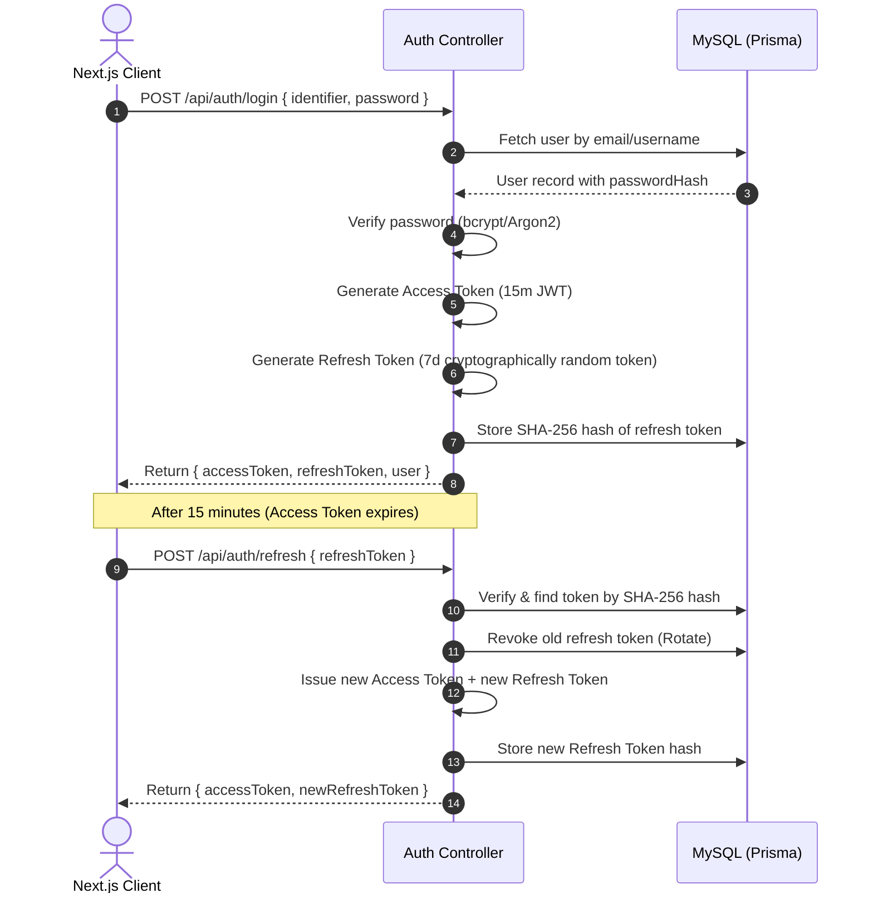

# Security Architecture & Threat Mitigation Plan

## Project: Simple Group Chat with AI

**Status:** Approved Security Specification  
**Lead Product Engineer:** Antigravity Team  

---

## 1. Core Security Principles

1. **Zero Client Trust:** The frontend is treated as completely untrusted. All authorization, role checks, room memberships, and file validations are strictly executed on the backend.
2. **Defense in Depth:** Security controls exist at the network layer (CORS, Helmet, Rate Limiting), authentication layer (JWT, Refresh Token rotation), authorization layer (RBAC, Group Membership guards), and application layer (Zod validation, SQL parameterization, sanitized rendering).
3. **Absolute Sandboxing of AI Output:** **AI-generated code is NEVER executed anywhere in the ecosystem.**

---

## 2. Authentication & Token Architecture



### 2.1 Password Hashing
- Algorithm: `bcrypt` with minimum work factor of 12 rounds (or `argon2id`).
- Passwords must satisfy complexity requirements enforced via Zod: minimum 8 characters, at least one uppercase letter, one lowercase letter, and one number.

### 2.2 JWT Access Tokens
- Expiration: 15 minutes.
- Cryptographic Signature: HMAC SHA-256 (`HS256`) signed with a high-entropy secret (`JWT_ACCESS_SECRET` >= 256 bits).
- Payload claims: `{ userId: string, email: string, username: string }`.

### 2.3 Refresh Token Security & Rotation
- Stored in MySQL `RefreshToken` table with hashed representation (`tokenHash = SHA256(rawToken)`).
- **Single-Use Rotation:** Every time a refresh token is exchanged, it is revoked and replaced with a new token.
- **Reuse Detection:** If an already-revoked refresh token is presented, the system treats it as an account compromise and revokes all active refresh tokens for that user.

---

## 3. Authorization & Role-Based Access Control (RBAC)

### 3.1 Backend Role Hierarchy
```text
OWNER (Super-Admin of the Group)
  └── ADMIN (Delegated Group Management)
        └── MEMBER (Standard Participant)
```

### 3.2 Authorization Middleware (`requireGroupRole`)
Every group endpoint and socket event enforces:
1. **Membership Verification:** Verifies the user is currently present in `GroupMember` for the target `groupId`.
2. **Role Verification:**
   - **`OWNER` Only:** Delete group, transfer ownership, promote/demote administrators.
   - **`ADMIN` or `OWNER`:** Update group name, description, avatar; add members; remove standard members. (Admins cannot remove other Admins or the Owner).
   - **`MEMBER`:** Send messages, upload attachments, leave group, pin group, block users.

### 3.3 Socket.IO Room Authorization Guard
- Clients cannot listen to group messages without completing room verification.
- In `join_group` handler:
  ```typescript
  const isMember = await prisma.groupMember.findUnique({
    where: { groupId_userId: { groupId, userId: socket.data.user.id } }
  });
  if (!isMember) {
    return ack({ success: false, error: "ACCESS_DENIED" });
  }
  socket.join(`group:${groupId}`);
  ```

---

## 4. AI Security & `@AI` Protection

### 4.1 CRITICAL: Zero Code Execution Rule
> [!CAUTION]
> **NEVER execute AI-generated code.**
> AI responses must NEVER be evaluated (`eval()`), executed in Node.js child processes, run in serverless containers, or executed against the database.
> The application ONLY renders text and code blocks for visual human inspection.

### 4.2 API Key Confidentiality
- External AI API keys (e.g. `GEMINI_API_KEY`, `OPENAI_API_KEY`) reside exclusively in backend environment variables.
- Zero references to AI keys exist in Next.js public code, client bundles, or repository source control.

### 4.3 Prompt Injection Defense & Sanitization
- Prompt templates strictly separate conversation history from system instructions using structural delimiters.
- Inputs are capped at 2,000 characters to prevent buffer and token-flooding attacks.
- Sensitive user data (password hashes, refresh tokens, deleted content) is never fed into the AI context window.

### 4.4 AI Rate Limiting
- To protect against quota depletion and denial-of-service:
  - Maximum **10 `@AI` queries per minute per group**.
  - Maximum **20 `@AI` queries per hour per user**.
  - Excessive triggers return a friendly system notice without invoking external APIs.

---

## 5. File Upload Security & Storage Abstraction

### 5.1 MIME Type & Extension Whitelisting
Only the following validated MIME types are accepted:
- **Images:** `image/jpeg`, `image/png`, `image/webp`, `image/gif` (Max 10 MB)
- **Videos:** `video/mp4`, `video/webm`, `video/quicktime` (Max 50 MB)
- **Audio:** `audio/webm`, `audio/mpeg`, `audio/ogg`, `audio/wav` (Max 15 MB)
- **Documents:** `application/pdf`, `text/plain`, `application/zip` (Max 25 MB)

### 5.2 Content & Header Verification
- File extension matching alone is insufficient.
- Uploads pass through a magic byte inspection (e.g., using `file-type`) to verify that the file header matches its claimed MIME type before persistent storage.
- Executable files (`.exe`, `.sh`, `.bat`, `.js`, `.html`, `.php`, `.vbs`) are permanently rejected.

### 5.3 Storage Sanitization
- Original file names are stripped of path traversal characters (`..`, `/`, `\`).
- Stored files receive random UUID keys (e.g., `uploads/media/2026/09/a8f3b2e1-4c12-4a55-89b3.png`).
- Direct script execution in the upload directory is disabled via web server configuration.

---

## 6. Web Application Vulnerability Defenses

### 6.1 Cross-Site Scripting (XSS)
- Frontend uses React and Next.js, which auto-escape variables by default.
- Markdown rendering for AI responses and user text uses `react-markdown` with `rehype-sanitize` to strip any `<script>`, `<iframe>`, or inline `onclick` handlers.
- Code blocks are highlighted using standard Prism/Shiki tokenizers that operate on pure string inputs.

### 6.2 Cross-Origin Resource Sharing (CORS) & Security Headers
- `cors` middleware explicitly restricts origins to trusted client URLs:
  ```typescript
  cors({
    origin: process.env.CLIENT_ORIGIN || "http://localhost:3000",
    credentials: true,
    methods: ["GET", "POST", "PATCH", "DELETE"]
  })
  ```
- `helmet` middleware sets essential security headers:
  - `Content-Security-Policy` (CSP)
  - `X-Frame-Options: DENY` (Anti-Clickjacking)
  - `X-Content-Type-Options: nosniff` (Anti-MIME sniffing)
  - `Strict-Transport-Security` (HSTS)

### 6.3 Rate Limiting
- `express-rate-limit` configurations:
  - Auth routes (`/api/auth/*`): 10 requests per 15 minutes per IP.
  - General API routes: 200 requests per 15 minutes per IP.
  - Media upload routes: 30 uploads per 15 minutes per user.

### 6.4 SQL Injection Defense
- Prisma ORM constructs parameterized SQL queries for all model operations, preventing SQL injection vulnerabilities.

---

## 7. Block User Privacy Enforcement

- When User A blocks User B:
  1. A relation is stored in `BlockedUser`.
  2. User B cannot view User A in user searches or add User A to new groups.
  3. In shared groups, messages from User B are flagged in the query response (`isBlockedSender: true`), and the UI renders them collapsed: *"Message from blocked user (Click to reveal)"*.
